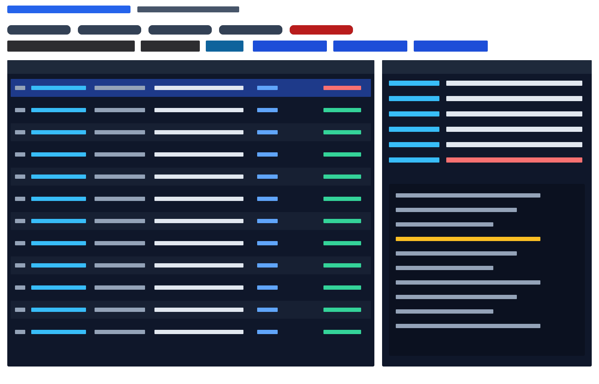

# Kubernetes Manifest Viewer for VS Code

Open Kubernetes YAML manifests in the editor without a cluster or `kubectl`. Multi-document manifests pack Deployments, Services, Ingress rules, ConfigMaps and RBAC policies into one file where misconfigured container flags, `:latest` tags and broken label selectors hide in hundreds of lines of YAML. This extension parses Kubernetes YAML locally in plain JavaScript with no cluster connection and no cloud upload.

## What it opens

- Kubernetes manifest files (`*.k8s.yaml`, `*.k8s.yml`, `deployment.yaml`, `service.yaml`, `ingress.yaml`, `kustomization.yaml`).
- Any open `.yaml` or `.yml` file via the Command Palette or Explorer context menu (Open in Kubernetes Manifest Viewer).
- Nothing to install, no cluster credentials needed, nothing uploaded.

## The free part

- Multi-document resource tree: lists every YAML document with Kind, Namespace, Name, Replicas, container count and check status.
- Container security posture checks: flags `privileged: true`, `runAsUser: 0` or missing `runAsNonRoot`, `allowPrivilegeEscalation: true`, missing CPU or memory limits, `:latest` or untagged images, deprecated `apiVersion` strings and hardcoded secret values.
- Label and selector match table: checks Service, Deployment and NetworkPolicy selectors against pod template labels in the file and flags orphaned selectors.
- Search and filter: filter resources by kind, name, namespace or check status offline.

## The Pro tools, with 1 free try

Pro adds the audit, comparison and export steps: generate a Markdown Kubernetes security and best-practice audit report across one file or a folder, compare two manifest files (such as staging and production) with replica, image and security deltas in Markdown, or export a CSV and Markdown workload inventory locally. Your first try of each Pro tool is free. Zovo Pro is USD 19 once, and the team licence is USD 59.

## Why not plain YAML

Plain text makes it easy to miss a privileged sidecar, a missing memory limit or a typo between a Service selector and a Deployment pod label. A local viewer puts the resource table, security findings and selector matches on one screen without connecting to a cluster.

## More tools by Zovo

See full docs and install options at [vscode.zovo.one/extensions/zovo-k8s-manifest-viewer/](https://vscode.zovo.one/extensions/zovo-k8s-manifest-viewer/), browse all Zovo VS Code extensions at [vscode.zovo.one](https://vscode.zovo.one/), or explore [Zovo Pro](https://vscode.zovo.one/pro/).
